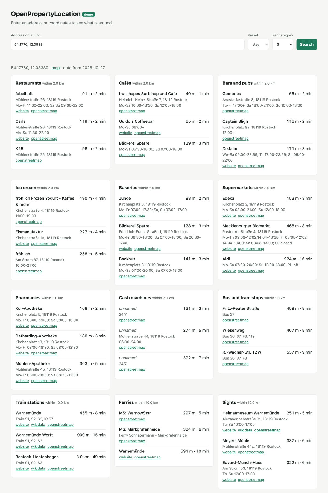

# OpenPropertyLocation

A small, self-hostable HTTP service: **coordinates or an address in,
structured surroundings out.**

For a location it returns the nearest supermarkets, bakeries, bus stops,
train stations, schools, beaches and more, grouped by category, with
distance and an estimated walking time, and the bus, tram and train lines
serving each stop. It is built on OpenStreetMap data, and prebuilt images
for Germany, Austria and Switzerland are available.

It is meant for property listings and vacation rentals: the "around the
stay" section of a guest page, or structured location facts next to the
free-text description of a flat for rent or sale.

**What it does not do:** OpenStreetMap has no ratings, so this service
returns facts about the surroundings, not quality judgements. There are no
reviews, photos, opening-hours evaluation, isochrones or real routing.

<picture>
  <source media="(prefers-color-scheme: dark)" srcset="docs/demo-dark.png">
  
</picture>

## Quick start

```sh
docker run -p 8080:8080 ghcr.io/ls-itsolutions/open-property-location:germany
```

```sh
curl 'http://localhost:8080/v1/surroundings?lat=54.1776&lon=12.0838&preset=stay'
```

The `germany` image contains the binary and the latest weekly data. It
needs well under 128 MB of RAM and runs as a non-root user on `linux/amd64`
and `linux/arm64`.

| Image tag | Contents |
|---|---|
| `germany`, `austria`, `switzerland` | binary + latest data of the country, rebuilt weekly |
| `germany-YYYY-MM-DD` (and so on) | binary + data of that OSM extract date |
| `<version>`, e.g. `1.1.0` | binary only; mount your own `places.db` at `/data/places.db` |

The databases are also attached to the GitHub releases `data-germany`,
`data-austria` and `data-switzerland`.

### Demo page

To try it in the browser, start the server with `--demo`:

```sh
docker run -p 8080:8080 ghcr.io/ls-itsolutions/open-property-location:germany serve --demo
```

and open <http://localhost:8080/demo/>. Enter an address or `lat, lon`,
pick a preset and see the results next to the raw API response. The page
is off by default and has no dependencies besides the API itself.

## API

### `GET /v1/surroundings`

| Parameter | Description |
|---|---|
| `lat`, `lon` | WGS84 coordinates |
| `address` | free text, geocoded with [Photon](https://photon.komoot.io) |
| `preset` | `stay` or `living`, see [Categories](#categories-and-presets) |
| `categories` | comma-separated category ids, e.g. `supermarket,school` |
| `limit` | places per category, 1–20, default 5 |

Give exactly one of `lat`/`lon` or `address`, and exactly one of `preset` or
`categories`.

```sh
curl 'http://localhost:8080/v1/surroundings?lat=54.1776&lon=12.0838&categories=bakery&limit=1'
```

```json
{
  "location": { "lat": 54.1776, "lon": 12.0838 },
  "categories": [
    {
      "id": "bakery",
      "places": [
        {
          "id": "node/123456",
          "name": "Bäckerei Beispiel",
          "lat": 54.1781,
          "lon": 12.0851,
          "distanceMeters": 120,
          "walkingMinutes": 2,
          "address": {
            "street": "Strandstraße",
            "houseNumber": "1",
            "postcode": "18119",
            "city": "Rostock"
          },
          "openingHours": "Mo-Sa 06:00-18:00",
          "website": "https://example.org",
          "wikidata": null,
          "lines": null,
          "osmUrl": "https://www.openstreetmap.org/node/123456"
        }
      ]
    }
  ],
  "dataVersion": "2026-10-26",
  "attribution": "© OpenStreetMap contributors, ODbL"
}
```

- Categories are returned in the requested order (for presets, the preset
  order). Categories without results have an empty `places` array.
- Optional fields (`name`, address parts, `openingHours`, `website`,
  `wikidata`, `lines`) are `null` when the OSM tag is missing. `website` is always an
  `http` or `https` URL. `openingHours` is the raw
  [OSM opening_hours](https://wiki.openstreetmap.org/wiki/Key:opening_hours)
  value.
- `distanceMeters` is the straight-line distance. For beaches, swimming
  spots and parks it is measured to the nearest edge of the area, and is `0`
  inside it. For other areas, such as a school ground or a parking lot, it
  is measured to the centroid.
- `lines` lists the public transport lines serving a stop, station or ferry
  terminal, sorted by mode (`train`, `light_rail`, `subway`, `tram`,
  `trolleybus`, `bus`, `ferry`) and then by `ref`:

  ```json
  "lines": [{ "mode": "train", "ref": "S1" }, { "mode": "bus", "ref": "36" }]
  ```

  They come from the OSM route relations the stop is a member of. A station
  that is not a member itself gets the lines of its stop area. How complete
  this is depends on the region: in cities almost every stop has its lines,
  in rural areas often only half of them. When stops with the same name are
  returned once, their lines are merged.
- `walkingMinutes` is an **estimate**, not a route:
  `ceil(distanceMeters × 1.3 / 80)`. The factor 1.3 accounts for detours,
  and 80 m/min is about 4.8 km/h.
- `dataVersion` is the date of the OpenStreetMap extract.
- Errors return `{ "error": "<message>" }` with `400` for invalid
  parameters, `404` when the address was not found and `502` when the
  geocoder failed.

**Ranking.** Within a category, places are sorted by
`distanceMeters / (1 + importance)`. `importance` (0 to 1) is computed when
the data is built: +0.5 for a `wikidata` or `wikipedia` tag, +0.2 for a
website, +0.1 for opening hours and +0.2 for `tourism=attraction` or any
`historic` tag. So a well-documented place may rank above a slightly closer
one. Categories without such tags (bus stops, parking) are sorted by
distance.

### `GET /v1/categories`

Lists all categories with their search radius, and the presets.

### `GET /health`

Returns `200` when the database is readable. The Docker image uses it for its
healthcheck (`opl healthcheck`).

## Categories and presets

| id | OSM tags | Radius |
|---|---|---|
| `restaurant` | `amenity=restaurant` | 2 km |
| `cafe` | `amenity=cafe` | 2 km |
| `bar` | `amenity=bar`, `pub`, `biergarten` | 2 km |
| `ice_cream` | `amenity=ice_cream` | 2 km |
| `bakery` | `shop=bakery` | 2 km |
| `supermarket` | `shop=supermarket` | 3 km |
| `pharmacy` | `amenity=pharmacy` | 3 km |
| `post_office` | `amenity=post_office` | 3 km |
| `atm` | `amenity=atm` | 2 km |
| `hospital` | `amenity=hospital` | 15 km |
| `paediatrician` | `healthcare:speciality=paediatrics` | 5 km |
| `doctor` | `amenity=doctors`, `clinic` | 3 km |
| `kindergarten` | `amenity=kindergarten`, `childcare` | 3 km |
| `school` | `amenity=school` | 5 km |
| `bus_tram_stop` | `highway=bus_stop`, `railway=tram_stop` | 1 km |
| `train_station` | `railway=station`, `halt` | 10 km |
| `ferry_terminal` | `amenity=ferry_terminal` | 10 km |
| `attraction` | `tourism=attraction`, `museum`, `viewpoint`; `historic=castle`, `monument` | 10 km |
| `beach` | `natural=beach` | 15 km |
| `swimming` | `leisure=swimming_area`, `bathing_place`, `water_park` | 10 km |
| `park` | `leisure=park` | 2 km |
| `playground` | `leisure=playground` | 1 km |
| `fitness` | `leisure=fitness_centre` | 3 km |
| `parking` | `amenity=parking` | 1 km |
| `ev_charging` | `amenity=charging_station` | 3 km |
| `bicycle_rental` | `amenity=bicycle_rental` | 2 km |

Presets:

- `stay` (vacation rentals): restaurant, cafe, bar, ice_cream, bakery,
  supermarket, pharmacy, atm, bus_tram_stop, train_station, ferry_terminal,
  attraction, beach, swimming, park, parking, ev_charging, bicycle_rental
- `living` (long-term rentals and sales): supermarket, bakery, pharmacy,
  post_office, atm, doctor, paediatrician, hospital, kindergarten, school,
  bus_tram_stop, train_station, park, playground, fitness

Places tagged `access=private` or `access=no` are left out. Most categories
only include places with a name; post offices, cash machines, beaches,
swimming spots, parks, playgrounds, parking, charging stations and bike
rentals are included without one. Stops, stations and ferry terminals with
the same name (OSM often has one per direction or line) are returned once.
A place that matches several categories belongs to the first one in the
table, so a paediatric practice is a `paediatrician`, not a `doctor`.

Category ids are a stable API contract. Clients translate them into their
own labels.

### Customizing

All of this is defined in
[`internal/categories/categories.yaml`](internal/categories/categories.yaml),
which is embedded into the binary and used both for building the data and
for serving. To change categories, radii or presets, fork the repository,
edit the file, and rebuild the binary and the data (see below). Changes to
`match` and `distanceToEdge` only take effect after the data is rebuilt.

## Building data

`places.db` is a single SQLite file built from a
[Geofabrik](https://download.geofabrik.de/) extract. You need Go and
[osmium-tool](https://osmcode.org/osmium-tool/) (`apt install osmium-tool`
or `brew install osmium-tool`).

```sh
scripts/build-data.sh europe/germany/bremen out   # small region for testing
scripts/build-data.sh europe/austria out          # any Geofabrik path works
```

The script downloads the extract, keeps only the tags used in
`categories.yaml` (`opl filter-expressions`) and the public transport route
relations (`opl filter-expressions --routes`), assembles geometries with
`osmium export` and imports both with `opl import`. The result is
`out/places.db`. Germany takes a while and needs about 10 GB of free disk
space; Bremen takes under a minute.

Run it with your own data:

```sh
docker run -p 8080:8080 -v "$PWD/out:/data:ro" ghcr.io/ls-itsolutions/open-property-location:<version>
# or without Docker
go run ./cmd/opl serve --data out/places.db
```

or build an image with the data baked in:

```sh
docker build --target with-data --build-context data=out -t my-surroundings .
```

## Configuration

| Flag | Environment | Default |
|---|---|---|
| `serve --data` | `OPL_DATA` | `places.db` (`/data/places.db` in the image) |
| `serve --addr` | `OPL_ADDR` | `:8080` |
| `serve --demo` | | off; serves the [demo page](#demo-page) at `/demo/` |
| | `PHOTON_URL` | `https://photon.komoot.io` |

The service has no authentication, rate limiting or CORS. Run it on an
internal network or behind your own reverse proxy.

### Geocoding and Photon fair use

Address input is forwarded to Photon. The public instance at
`photon.komoot.io` is provided by Komoot under a
[fair-use policy](https://photon.komoot.io): it is fine for occasional
requests, but if you geocode a lot, run your own Photon instance and set
`PHOTON_URL`. Coordinates input never calls the geocoder.

## Licensing and attribution

- The code is licensed under the [MIT License](LICENSE).
- The data comes from [OpenStreetMap](https://www.openstreetmap.org/copyright)
  and is licensed under the
  [Open Database License (ODbL) 1.0](https://opendatacommons.org/licenses/odbl/1-0/).
  `places.db` is a derivative database and is distributed under the ODbL
  as well; see [LICENSE-DATA](LICENSE-DATA).
- **Clients must display the attribution** returned in every response
  (`© OpenStreetMap contributors, ODbL`), ideally linking to
  <https://www.openstreetmap.org/copyright>, wherever they show the data.

## Development

```sh
go test ./...
go run ./cmd/opl --help
```

The CI workflow builds Bremen on every push and runs a smoke test against
it. The data workflow builds Germany, Austria and Switzerland weekly, checks
each (Berlin Alexanderplatz, Wien Hauptbahnhof and Zürich HB must have a
train station with lines within 500 m, plus size and per-category counts)
and only then publishes the image and the `data-<country>` release asset.
