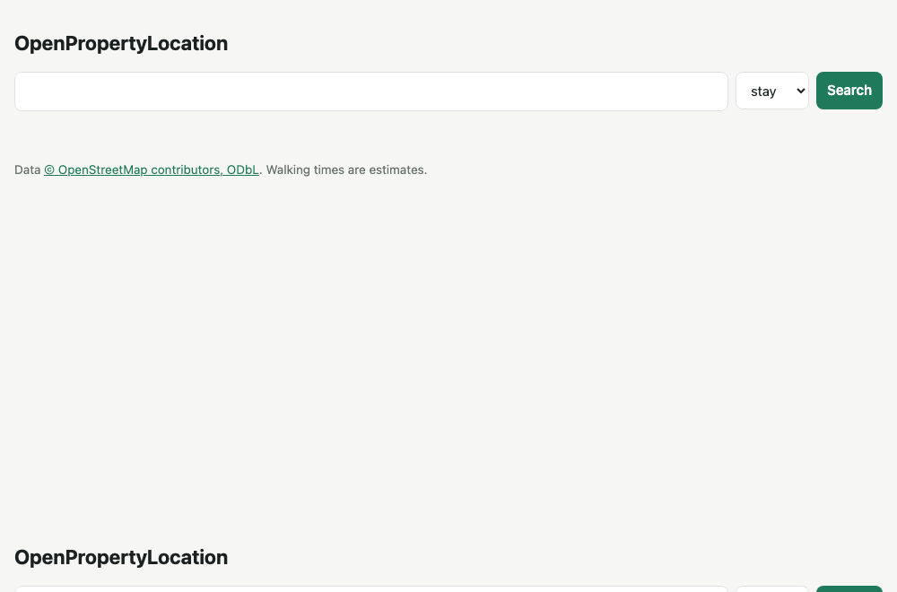

<div align="center">

# OpenPropertyLocation

**What's around this address?**<br>
Send an address, get the nearest supermarkets, bakeries, schools, stops and
beaches with walking times, transit lines and how often they run. For your
app or your AI assistant (MCP). Self-hosted, built on OpenStreetMap, one
`docker run`.

[](https://github.com/ls-itsolutions/open-property-location/actions/workflows/ci.yml)
[](https://github.com/ls-itsolutions/open-property-location/actions/workflows/data.yml)
[](LICENSE)

<picture>
  <source media="(prefers-color-scheme: dark)" srcset="docs/demo-dark.gif">
  
</picture>

</div>

## Try it

```sh
docker run -p 8080:8080 ghcr.io/ls-itsolutions/open-property-location:germany serve --demo
```

Germany, Austria, Switzerland, the Netherlands, Denmark, Italy, Spain and
Croatia each have their own image, see [Regions](#regions). Open
<http://localhost:8080/demo/> for the page above, or ask the API:

```sh
curl -G http://localhost:8080/v1/surroundings \
  --data-urlencode 'address=Am Strom 59, Rostock' \
  -d categories=supermarket,train_station -d limit=1
```

```jsonc
{
  "location": { "lat": 54.1766006, "lon": 12.0881239 },
  "categories": [
    {
      "id": "supermarket",
      "places": [{ "name": "Edeka", "distanceMeters": 230, "walkingMinutes": 4, /* … */ }]
    },
    {
      "id": "train_station",
      "places": [{
        "name": "Warnemünde", "distanceMeters": 182, "walkingMinutes": 3,
        "lines": [{ "mode": "train", "ref": "S1" }, { "mode": "train", "ref": "S2" }, /* … */ ],
        /* … */
      }]
    }
  ],
  "dataVersion": "2026-10-27",
  "attribution": "© OpenStreetMap contributors, ODbL; timetables: DELFI e.V. via gtfs.de, CC BY 4.0"
}
```

## Use it from an AI assistant (MCP)

OpenPropertyLocation is also a [Model Context Protocol](https://modelcontextprotocol.io)
server. Claude, Cursor, VS Code and other MCP clients can then answer
questions like *"What's within walking distance of Am Strom 59 in Rostock,
and how often does the train go?"* or write the location section of a
listing from real data.

Claude Code:

```sh
claude mcp add surroundings -- docker run -i --rm ghcr.io/ls-itsolutions/open-property-location:germany mcp
```

Claude Desktop, Cursor, VS Code and other clients with a JSON config:

```json
{
  "mcpServers": {
    "surroundings": {
      "command": "docker",
      "args": ["run", "-i", "--rm", "ghcr.io/ls-itsolutions/open-property-location:germany", "mcp"]
    }
  }
}
```

A running server also speaks MCP over HTTP at `/mcp` (Streamable HTTP):

```sh
claude mcp add --transport http surroundings http://localhost:8080/mcp
```

Two tools: `get_surroundings` takes the same parameters as
[`/v1/surroundings`](#get-v1surroundings) and returns the same JSON,
`list_categories` lists categories and presets. Both are read-only. Use
another image tag, such as `austria`, for another region.

## Use it in your app

One GET request, no API key, no SDK:

```js
const url = new URL("http://localhost:8080/v1/surroundings");
url.searchParams.set("address", "Am Strom 59, Rostock");
url.searchParams.set("categories", "supermarket,school,train_station");
url.searchParams.set("limit", "1");

const { categories } = await fetch(url).then((r) => r.json());
for (const { id, places } of categories) {
  for (const place of places) {
    console.log(`${id}: ${place.name}, ${place.walkingMinutes} min walk`);
  }
}
// supermarket: Edeka, 4 min walk
// school: Ecolea - Internationale Schule Rostock, 5 min walk
// train_station: Warnemünde, 3 min walk
```

Or ask for a whole preset with `preset=stay` (holiday rentals) or
`preset=living` (flats and houses) and get up to five places for each of
their categories. Call it from your backend once per property, cache the
result and show the `attribution` next to it.

## Why

- **One container, data included.** Eight countries, rebuilt weekly from
  OpenStreetMap. No API key, no database server, under 128 MB of RAM.
- **Ready to display.** 26 categories, grouped and ranked, with walking
  minutes, the bus, tram and train lines at each stop, and the distance to
  the edge of beaches and parks.
- **How good is the bus?** In Germany, Switzerland and the Netherlands each
  stop and station also says how many departures it has per hour, from the
  official open timetables. "Bus every 10 minutes" and "twice a day" both
  look like a bus stop on a map.
- **Made for AI assistants too.** The same data as an [MCP](#use-it-from-an-ai-assistant-mcp)
  server, so an assistant can describe a location without guessing.
- **Address or coordinates.** Addresses are geocoded with
  [Photon](https://photon.komoot.io); stored coordinates need no geocoder,
  so nothing leaves your network.
- **Open.** MIT-licensed code, ODbL data in a single SQLite file.

**What it does not do:** ratings and reviews. OpenStreetMap has none, and
there is no free source with enough coverage to add them (the open review
project [Mangrove](https://mangrove.reviews) has only a few reviews so far).
There are also no photos, opening-hours evaluation, isochrones or real
routing.

## Compared to other options

- **Overpass API:** raw OpenStreetMap queries. The public instances are
  rate-limited and not meant for production use, and you get raw elements
  without categories, ranking or walking times.
- **Hosted places APIs** (Google Places, Geoapify and others): more data,
  some with ratings, but paid beyond a free tier, often with terms on
  caching and displaying results, and your coordinates leave your network.
- **openpoiservice:** self-hosted points of interest from OpenStreetMap,
  but it needs PostGIS and has no presets, ranking or address input.
- **Walk Score and similar scores:** one proprietary number per location.
  OpenPropertyLocation returns the places themselves, so you decide how to
  present them.
- **Other OpenStreetMap MCP servers:** query the public Overpass and
  Nominatim APIs live, with their rate limits and without categories,
  ranking or timetables.

## API

The full reference is in [`openapi.yaml`](openapi.yaml) (OpenAPI 3.1), so
you can generate a client for any language.

### `GET /v1/surroundings`

| Parameter | Description |
|---|---|
| `lat`, `lon` | WGS84 coordinates |
| `address` | free text, geocoded with [Photon](https://photon.komoot.io) |
| `preset` | `stay` or `living`, see [Categories](#categories-and-presets) |
| `categories` | comma-separated category ids, e.g. `supermarket,school` |
| `limit` | places per category, 1–20, default 5 |

Give exactly one of `lat`/`lon` or `address`, and exactly one of `preset` or
`categories`.

```sh
curl 'http://localhost:8080/v1/surroundings?lat=54.1776&lon=12.0838&categories=bakery&limit=1'
```

```json
{
  "location": { "lat": 54.1776, "lon": 12.0838 },
  "categories": [
    {
      "id": "bakery",
      "places": [
        {
          "id": "node/123456",
          "name": "Bäckerei Beispiel",
          "lat": 54.1781,
          "lon": 12.0851,
          "distanceMeters": 120,
          "walkingMinutes": 2,
          "address": {
            "street": "Strandstraße",
            "houseNumber": "1",
            "postcode": "18119",
            "city": "Rostock"
          },
          "openingHours": "Mo-Sa 06:00-18:00",
          "website": "https://example.org",
          "wikidata": null,
          "lines": null,
          "departuresPerHour": null,
          "osmUrl": "https://www.openstreetmap.org/node/123456"
        }
      ]
    }
  ],
  "dataVersion": "2026-10-26",
  "attribution": "© OpenStreetMap contributors, ODbL"
}
```

- Categories are returned in the requested order (for presets, the preset
  order). Categories without results have an empty `places` array.
- Optional fields (`name`, address parts, `openingHours`, `website`,
  `wikidata`, `lines`, `departuresPerHour`) are `null` when the data is
  missing. `website` is always an
  `http` or `https` URL. `openingHours` is the raw
  [OSM opening_hours](https://wiki.openstreetmap.org/wiki/Key:opening_hours)
  value.
- `distanceMeters` is the straight-line distance. For beaches, swimming
  spots and parks it is measured to the nearest edge of the area, and is `0`
  inside it. For other areas, such as a school ground or a parking lot, it
  is measured to the centroid.
- `lines` lists the public transport lines serving a stop, station or ferry
  terminal, sorted by mode (`train`, `light_rail`, `subway`, `tram`,
  `trolleybus`, `bus`, `ferry`) and then by `ref`:

  ```json
  "lines": [{ "mode": "train", "ref": "S1" }, { "mode": "bus", "ref": "36" }]
  ```

  They come from the OSM route relations the stop is a member of. A station
  that is not a member itself gets the lines of its stop area. How complete
  this is depends on the region: in cities almost every stop has its lines,
  in rural areas often only half of them. When stops with the same name are
  returned once, their lines are merged.
- `departuresPerHour` says how often public transport leaves a stop,
  station or ferry terminal: the average per hour on a weekday (a Tuesday a
  few weeks after the data build) between 06:00 and 20:00, all lines and
  directions together, with one decimal (`0.5` is one every two hours). It
  is counted from the region's GTFS timetable at the timetable stops within
  50 m of a bus or tram stop, 300 m of a station and 200 m of a ferry
  terminal, and is `null` where the region has no open timetable or none of
  its stops is nearby. About 90 % of the bus and tram stops have it in
  Bremen, Switzerland and the Netherlands; Bremen Hauptbahnhof has 20.4
  trains per hour.
- `walkingMinutes` is an **estimate**, not a route:
  `ceil(distanceMeters × 1.3 / 80)`. The factor 1.3 accounts for detours,
  and 80 m/min is about 4.8 km/h.
- `dataVersion` is the date of the OpenStreetMap extract.
- `attribution` credits the data sources and must be shown with the data.
  It also names the timetable feed where departures are included.
- Errors return `{ "error": "<message>" }` with `400` for invalid
  parameters, `404` when the address was not found and `502` when the
  geocoder failed.

**Ranking.** Within a category, places are sorted by
`distanceMeters / (1 + importance)`. `importance` (0 to 1) is computed when
the data is built: +0.5 for a `wikidata` or `wikipedia` tag, +0.2 for a
website, +0.1 for opening hours and +0.2 for `tourism=attraction` or any
`historic` tag. So a well-documented place may rank above a slightly closer
one. Categories without such tags (bus stops, parking) are sorted by
distance.

### `GET /v1/categories`

Lists all categories with their search radius, and the presets.

### `POST /mcp`

The [MCP](#use-it-from-an-ai-assistant-mcp) endpoint. Requests from a web
page of another host (an `Origin` header that does not match) are rejected.

### `GET /health`

Returns `200` when the database is readable. The Docker image uses it for its
healthcheck (`opl healthcheck`).

## Categories and presets

<details>
<summary>All 26 categories with their OSM tags and search radius</summary>

| id | OSM tags | Radius |
|---|---|---|
| `restaurant` | `amenity=restaurant` | 2 km |
| `cafe` | `amenity=cafe` | 2 km |
| `bar` | `amenity=bar`, `pub`, `biergarten` | 2 km |
| `ice_cream` | `amenity=ice_cream` | 2 km |
| `bakery` | `shop=bakery` | 2 km |
| `supermarket` | `shop=supermarket` | 3 km |
| `pharmacy` | `amenity=pharmacy` | 3 km |
| `post_office` | `amenity=post_office` | 3 km |
| `atm` | `amenity=atm` | 2 km |
| `hospital` | `amenity=hospital` | 15 km |
| `paediatrician` | `healthcare:speciality=paediatrics` | 5 km |
| `doctor` | `amenity=doctors`, `clinic` | 3 km |
| `kindergarten` | `amenity=kindergarten`, `childcare` | 3 km |
| `school` | `amenity=school` | 5 km |
| `bus_tram_stop` | `highway=bus_stop`, `railway=tram_stop` | 1 km |
| `train_station` | `railway=station`, `halt` | 10 km |
| `ferry_terminal` | `amenity=ferry_terminal` | 10 km |
| `attraction` | `tourism=attraction`, `museum`, `viewpoint`; `historic=castle`, `monument` | 10 km |
| `beach` | `natural=beach` | 15 km |
| `swimming` | `leisure=swimming_area`, `bathing_place`, `water_park` | 10 km |
| `park` | `leisure=park` | 2 km |
| `playground` | `leisure=playground` | 1 km |
| `fitness` | `leisure=fitness_centre` | 3 km |
| `parking` | `amenity=parking` | 1 km |
| `ev_charging` | `amenity=charging_station` | 3 km |
| `bicycle_rental` | `amenity=bicycle_rental` | 2 km |

</details>

Presets:

- `stay` (vacation rentals): restaurant, cafe, bar, ice_cream, bakery,
  supermarket, pharmacy, atm, bus_tram_stop, train_station, ferry_terminal,
  attraction, beach, swimming, park, parking, ev_charging, bicycle_rental
- `living` (long-term rentals and sales): supermarket, bakery, pharmacy,
  post_office, atm, doctor, paediatrician, hospital, kindergarten, school,
  bus_tram_stop, train_station, park, playground, fitness

Places tagged `access=private` or `access=no` are left out. Most categories
only include places with a name; post offices, cash machines, beaches,
swimming spots, parks, playgrounds, parking, charging stations and bike
rentals are included without one. Stops, stations and ferry terminals with
the same name (OSM often has one per direction or line) are returned once.
A place that matches several categories belongs to the first one in the
table, so a paediatric practice is a `paediatrician`, not a `doctor`.

Category ids are a stable API contract. Clients translate them into their
own labels.

### Customizing

All of this is defined in
[`internal/categories/categories.yaml`](internal/categories/categories.yaml),
which is embedded into the binary and used both for building the data and
for serving. To change categories, radii or presets, fork the repository,
edit the file, and rebuild the binary and the data (see below). Changes to
`match`, `distanceToEdge` and `departures` only take effect after the data
is rebuilt.

## Running it

### Regions

| Region | Image tag | Departures per hour from |
|---|---|---|
| Germany | `germany` | [gtfs.de](https://gtfs.de) (DELFI e.V., CC BY 4.0) |
| Austria | `austria` | — (the national feed needs a registration) |
| Switzerland | `switzerland` | [opentransportdata.swiss](https://opentransportdata.swiss) |
| Netherlands | `netherlands` | [OVapi](https://gtfs.ovapi.nl) (CC0) |
| Denmark | `denmark` | — (the national feed needs an account) |
| Italy | `italy` | — (no national feed) |
| Spain | `spain` | — (no national feed) |
| Croatia | `croatia` | — (no national feed) |

| Image tag | Contents |
|---|---|
| `<region>` | binary + latest data of the region, rebuilt weekly |
| `<region>-YYYY-MM-DD` | binary + data of that OSM extract date |
| `<version>`, e.g. `1.1.0` | binary only; mount your own `places.db` at `/data/places.db` |

The images need well under 128 MB of RAM and run as a non-root user on
`linux/amd64` and `linux/arm64`. Without `serve --demo` they serve only the
API and `/mcp`. The databases are also attached to the GitHub releases
`data-<region>`, such as `data-germany`.

### Configuration

| Flag | Environment | Default |
|---|---|---|
| `serve --data` | `OPL_DATA` | `places.db` (`/data/places.db` in the image) |
| `serve --addr` | `OPL_ADDR` | `:8080` |
| `serve --demo` | | off; serves the [demo page](#try-it) at `/demo/` |
| `mcp --data` | `OPL_DATA` | MCP on stdin/stdout instead of HTTP |
| | `PHOTON_URL` | `https://photon.komoot.io` |

The service has no authentication, rate limiting or CORS. Run it on an
internal network or behind your own reverse proxy.

#### Geocoding and Photon fair use

Address input is forwarded to Photon. The public instance at
`photon.komoot.io` is provided by Komoot under a
[fair-use policy](https://photon.komoot.io): it is fine for occasional
requests, but if you geocode a lot, run your own Photon instance and set
`PHOTON_URL`. Coordinates input never calls the geocoder.

### Building data

`places.db` is a single SQLite file built from a
[Geofabrik](https://download.geofabrik.de/) extract. You need Go and
[osmium-tool](https://osmcode.org/osmium-tool/) (`apt install osmium-tool`
or `brew install osmium-tool`).

```sh
scripts/build-data.sh europe/germany/bremen out   # small region for testing
scripts/build-data.sh europe/austria out          # any Geofabrik path works

# with departures from a GTFS feed: URL and the credit for the attribution
scripts/build-data.sh europe/germany/bremen out \
  https://download.gtfs.de/germany/free/latest.zip "DELFI e.V. via gtfs.de, CC BY 4.0"
```

The script downloads the extract, keeps only the tags used in
`categories.yaml` (`opl filter-expressions`) and the public transport route
relations (`opl filter-expressions --routes`), assembles geometries with
`osmium export` and imports both with `opl import`. With a GTFS feed it
counts the departures of every timetable stop and attaches them to the
stops nearby. The result is `out/places.db`. Germany takes a while and
needs about 10 GB of free disk space; Bremen takes under a minute.

Any GTFS feed works, also one of a single transport association: stops
outside the feed just have no departures. Check its license and pass the
credit it requires.

Run it with your own data:

```sh
docker run -p 8080:8080 -v "$PWD/out:/data:ro" ghcr.io/ls-itsolutions/open-property-location:<version>
# or without Docker
go run ./cmd/opl serve --data out/places.db
```

or build an image with the data baked in:

```sh
docker build --target with-data --build-context data=out -t my-surroundings .
```

## Licensing and attribution

- The code is licensed under the [MIT License](LICENSE).
- The data comes from [OpenStreetMap](https://www.openstreetmap.org/copyright)
  and is licensed under the
  [Open Database License (ODbL) 1.0](https://opendatacommons.org/licenses/odbl/1-0/).
  `places.db` is a derivative database and is distributed under the ODbL
  as well; see [LICENSE-DATA](LICENSE-DATA).
- Departures come from the open timetables listed under
  [Regions](#regions), under their licenses; see LICENSE-DATA.
- **Clients must display the attribution** returned in every response
  (`© OpenStreetMap contributors, ODbL`, plus the timetable credit where
  departures are included), ideally linking to
  <https://www.openstreetmap.org/copyright>, wherever they show the data.

## Development

```sh
go test ./...
go run ./cmd/opl --help
```

The CI workflow builds Bremen on every push and runs a smoke test against
it. The data workflow builds every region weekly, checks each (the main
station of the capital must be a train station with lines within 500 m,
with departures where the region has a timetable, plus size and
per-category counts) and only then publishes the image and the
`data-<region>` release asset. If it fails, it opens an issue and closes it
once a build passes again.

Dependabot updates are merged automatically when all checks pass, except
major versions. Once a month the release workflow drafts the next release
if the binary changed; publishing the draft tags it and CI pushes the image.
